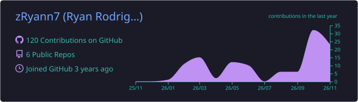
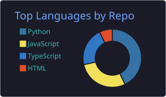

# Ryan Rodrigues

### Backend Developer | Python • Node.js • APIs

Construindo APIs, integrações e aplicações para resolver problemas reais.

---

## 👨‍💻 Sobre mim

Sou desenvolvedor com foco em **Backend e desenvolvimento de sistemas**. Trabalho principalmente com Python e Node.js, criando APIs, integrações e aplicações que organizam processos e resolvem problemas do dia a dia.

Tenho experiência prática com desenvolvimento full stack, bancos de dados, autenticação, controle de acesso, testes automatizados e publicação de aplicações. Gosto de entender o problema antes de implementar a solução e manter o código organizado, seguro e fácil de dar manutenção.

## 🧰 Tecnologias e ferramentas

**Backend**
 

**Frontend**
 

**Dados, infraestrutura e qualidade**
 

## 🚀 Projetos em destaque

### 💰 [Finance App](https://github.com/zRyann7/finance-app)

Aplicação full stack para controle de finanças pessoais, com cadastro de usuários, receitas, despesas, metas e contas recorrentes.

- API com **Node.js e Express** e interface em **React**.
- Supabase para autenticação e persistência dos dados.
- **Row Level Security (RLS)** para isolar os dados de cada usuário.
- Mais de 100 testes automatizados entre backend e frontend.
- CI com GitHub Actions, migrations SQL e suporte a Docker.
- Aplicação publicada: frontend na Vercel e backend no Render.

### 🏭 Industrial Manager

Projeto em desenvolvimento para gestão industrial, pensado para conectar informações de produção e estoque. A proposta é complementar o acompanhamento de ordens de produção com uma visão organizada dos materiais e depósitos.

### ⚙️ Automações e integrações

Desenvolvimento de automações em Python para reduzir tarefas manuais e integrar serviços, incluindo monitoramento de conectividade de VPNs e comunicação com APIs externas a partir de dados armazenados no Supabase.

## 📊 GitHub

## 🎯 Interesses

Backend • APIs REST • Modelagem de dados • Segurança de aplicações • Automação • Arquitetura de software

---

*Tecnologia faz sentido quando resolve problemas.*

